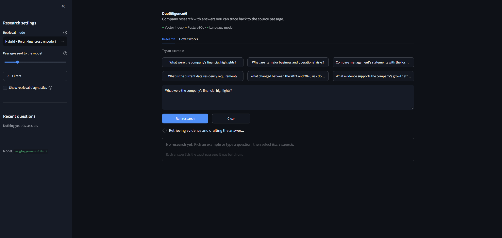
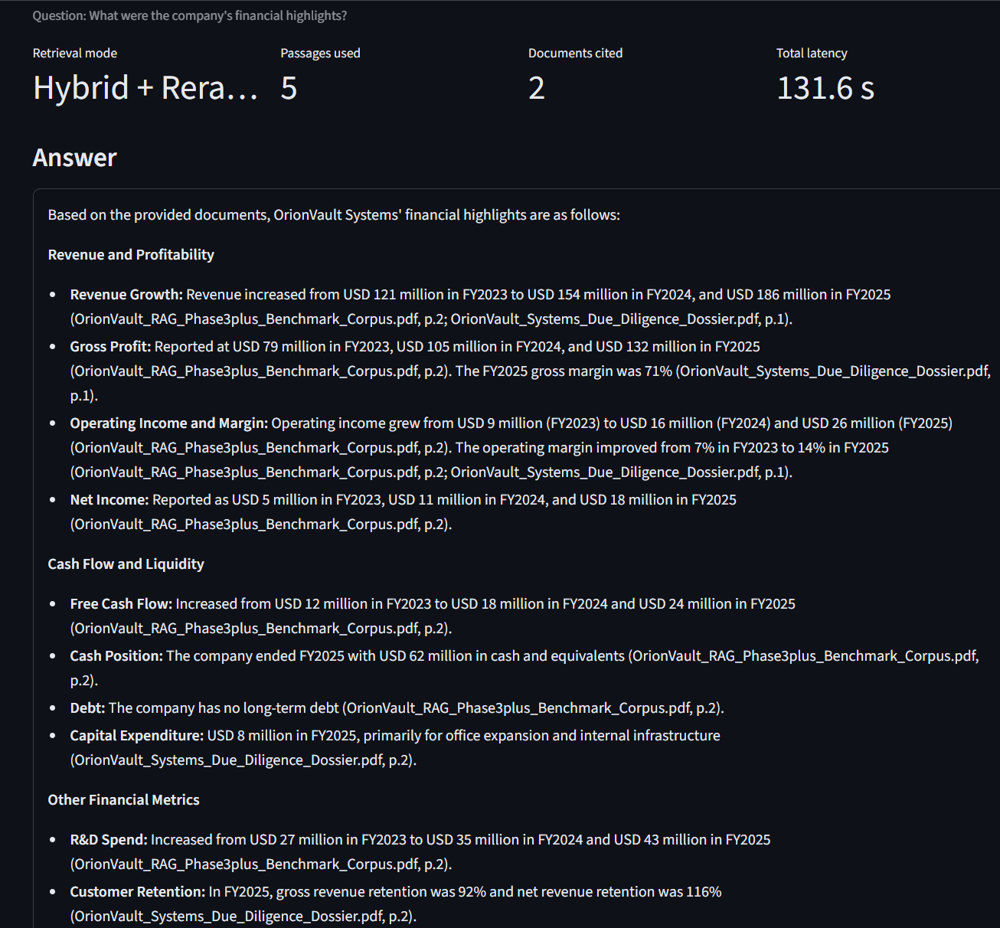
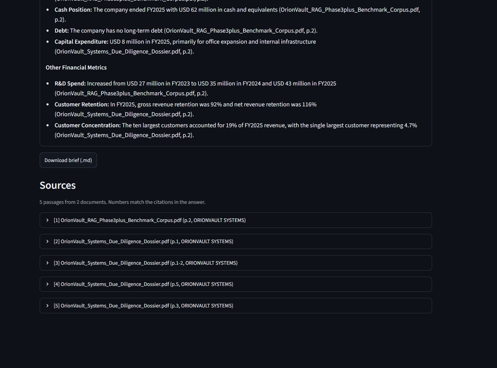
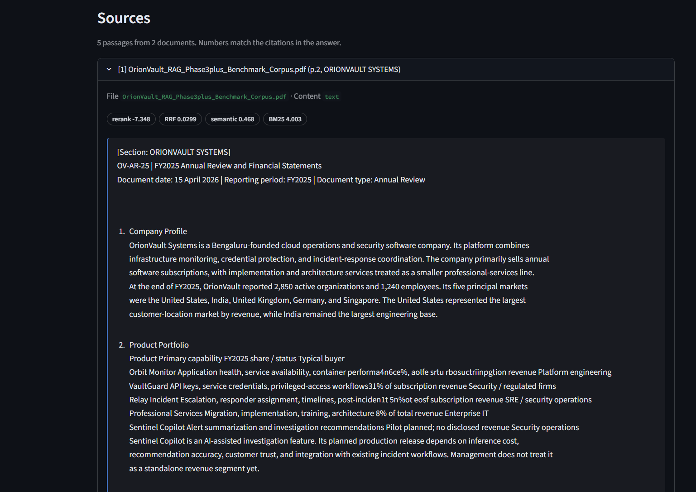

# DueDiligenceAI

**Evidence-grounded company research powered by retrieval-augmented generation (RAG).**

DueDiligenceAI turns company documents into a searchable research workspace. It combines document-aware ingestion, semantic and keyword retrieval, result fusion, reranking, and a PostgreSQL/pgvector knowledge layer to retrieve relevant evidence and generate answers with source context.

The repository is designed to make retrieval decisions inspectable: you can see which chunks were retrieved, where they came from, how they were ranked, and how retrieval strategies compare.

> **Important:** The included OrionVault Systems company and documents are fictional and exist only for development and evaluation.

## Key capabilities

- **Document ingestion:** Extracts PDF text page by page and retains source and page information.
- **Structure-aware chunking:** Preserves headings, section paths, and table-like content where extraction permits; keeps source text linked to each chunk.
- **Semantic retrieval:** Uses `BAAI/bge-base-en-v1.5` embeddings and FAISS for a local vector-search baseline.
- **Keyword retrieval:** Uses BM25 to surface exact product names, identifiers, terminology, and numerical terms that semantic search may rank poorly.
- **Hybrid retrieval:** Combines semantic and keyword rankings with Reciprocal Rank Fusion (RRF).
- **Cross-encoder reranking:** Re-scores query–chunk pairs before selecting the final context for answer generation.
- **Relational knowledge layer:** Uses PostgreSQL and pgvector to store documents, versions, chunks, embeddings, and structured metadata together.
- **Metadata and version-aware retrieval:** Supports narrowing results by document attributes and retaining the provenance needed to distinguish current from historical source material.
- **Retrieval diagnostics:** Inspect intermediate results, rankings, sources, pages, and scores instead of treating retrieval as a black box.
- **Evaluation tooling:** Runs a labeled retrieval benchmark to compare retrieval modes and inspect failure cases.

## User Interface

DueDiligenceAI provides a dedicated research workspace built with Streamlit for evidence-grounded analysis, retrieval mode configuration, and source provenance inspection.

| Research Workspace & Query Execution | Evidence-Grounded Answer & Metrics |
| :---: | :---: |
|  |  |

| Collapsible Source Attribution | Chunk Provenance & Diagnostic Scores |
| :---: | :---: |
|  |  |

## Architecture

### Ingestion

```text
PDF documents
     │
     ▼
Page-level text extraction
     │
     ▼
Normalization + structure detection
     │
     ▼
Structure-aware chunks + metadata
     │
     ├──────────────► Embeddings ───────────────► FAISS index
     │
     └──────────────► PostgreSQL + pgvector
                       documents · versions
                       sections · chunks · sources
```

### Query and retrieval

```text
User question
     │
     ├──────────────► Semantic retrieval (embeddings)
     │
     └──────────────► Keyword retrieval (BM25)
                              │
                              ▼
                    Reciprocal Rank Fusion
                              │
                              ▼
                     Cross-encoder reranker
                              │
                              ▼
                    Selected evidence chunks
                              │
                              ▼
                    Context-grounded generation
                              │
                              ▼
                   Answer + source references
```

The local FAISS pipeline provides a useful baseline. The PostgreSQL/pgvector layer adds relational metadata and document/version relationships alongside vector search. Retrieval modes can be compared to understand the effect of each retrieval component.

## Technology stack

| Area | Technology | Purpose |
|---|---|---|
| Language | Python 3.11+ | Application and retrieval pipeline |
| PDF extraction | `pypdf`, `pdfplumber` | Page text extraction and table-aware parsing |
| Chunking | `tiktoken` + custom Python logic | Token counting and chunk boundaries |
| Embeddings | `sentence-transformers`, `BAAI/bge-base-en-v1.5` | Local 768-dimensional text embeddings |
| Vector baseline | FAISS `IndexFlatIP` | Exact local similarity search over normalized vectors |
| Keyword retrieval | `rank-bm25` | Lexical relevance scoring |
| Rank fusion | Reciprocal Rank Fusion | Combines independently ranked result lists |
| Reranking | `cross-encoder/ms-marco-MiniLM-L-6-v2` | Ranks query–chunk pairs for relevance |
| Knowledge store | PostgreSQL + pgvector | Vector search, relational metadata, and provenance |
| Generation | OpenRouter API | Generates answers from selected evidence |
| Interface | Streamlit | Interactive research workspace and retrieval inspector |
| Testing | `pytest` | Unit and integration tests |

## Retrieval modes

The retriever exposes separate modes so their behavior can be evaluated rather than assumed.

| Mode | What it tests |
|---|---|
| `VECTOR_ONLY` | Semantic similarity from embeddings |
| `KEYWORD_ONLY` | Lexical matching with BM25 |
| `HYBRID` | Semantic + keyword retrieval merged with RRF |
| `HYBRID_RERANKED` | Hybrid candidate retrieval followed by cross-encoder reranking |

Use vector retrieval for meaning and paraphrases, keyword retrieval for exact terminology and identifiers, and hybrid retrieval when both signals may matter. Reranking improves ordering only among candidates already retrieved; it cannot recover evidence that never entered the candidate set.

## Knowledge model

The PostgreSQL-backed store represents the corpus as related records rather than unconnected text chunks. The model tracks companies, documents, document versions, sections, chunks, sources, and structured financial metrics where available.

This supports questions such as:

- Which source and page support a retrieved passage?
- Which version of a policy applies to a particular date?
- Can retrieval be restricted to a document type or section?
- Can structured financial values be queried separately from prose evidence?

Vector similarity is not a replacement for relational constraints. Dates, document types, version status, and provenance should be represented as data that can be queried directly.

## Example research questions

Using the fictional OrionVault Systems corpus, try:

- What were OrionVault's revenue and operating margin in FY2025?
- What risks come from dependence on external cloud infrastructure?
- What does Sentinel Copilot do, and what risks are associated with it?
- What internal identifier is used for Sentinel Copilot?
- Compare management's comments about Sentinel Copilot with formal risk disclosures.
- How did the company's risk profile change between the 2024 and 2026 risk documents?
- What data-residency policy applies to Germany, and which source version supports the answer?

These questions are intentionally varied: some test semantic similarity, some rely on exact terms, and others require evidence from multiple source documents or versions.

## Getting started

### Prerequisites

- Python 3.11 or newer
- An OpenRouter API key for answer generation
- PostgreSQL with the `vector` extension enabled for database-backed retrieval

### 1. Install dependencies

```powershell
python -m venv .venv
.venv\Scripts\Activate.ps1
python -m pip install --upgrade pip
pip install -r requirements.txt
```

On macOS/Linux, activate the environment with `source .venv/bin/activate` instead.

### 2. Configure environment variables

```powershell
Copy-Item .env.example .env
```

Set `OPENROUTER_API_KEY` in `.env`. Configure PostgreSQL connection settings using the variable names documented in `.env.example` for the database-backed retrieval path. Do not commit `.env` or API keys.

### 3. Add the sample corpus

Place the fictional OrionVault PDF corpus in `data/raw/`. Keep source PDFs unchanged so retrieved evidence can be traced back to the original document and page.

### 4. Ingest documents

For the local FAISS workflow:

```powershell
python scripts/ingest.py --strategy structure_aware
```

To compare fixed-size and structure-aware chunking, build both indexes:

```powershell
python scripts/ingest.py --strategy fixed
python scripts/ingest.py --strategy structure_aware
```

For PostgreSQL-backed retrieval, configure the database, apply the repository's database migrations, and run its database ingestion workflow before selecting the database-backed retriever.

### 5. Run the application

**Launch the Streamlit research interface:**

```powershell
streamlit run ui.py
```

**Or run the terminal CLI:**

```powershell
python app.py
```

### 6. Inspect retrieval results

```powershell
python scripts/inspect_retrieval.py "What are the risks associated with Sentinel Copilot?"
python scripts/inspect_retrieval.py "What are the corrective actions for the VaultGuard event?" --mode KEYWORD_ONLY
```

### 7. Run the retrieval benchmark

```powershell
python scripts/evaluate_retrieval.py
```

### 8. Run tests

```powershell
python -m pytest tests/ -v
```

> Commands for database migrations and database ingestion depend on the migration and script names present in the checked-out repository. Use the checked-in migration configuration and `scripts/` directory as the source of truth.

## Evaluation approach

The project includes a manually labeled retrieval benchmark and tooling for comparing retrieval configurations. The benchmark is intended to surface cases where one method succeeds and another fails—not to assume that hybrid search or reranking always wins.

Useful measurements include:

- **Hit Rate / Recall@K:** Whether relevant evidence appears in the retrieved set.
- **Precision@K:** How much of the selected result set is relevant.
- **MRR:** How highly the first relevant result is ranked.
- **Latency:** The retrieval-time cost of each configuration.

When comparing results, keep the corpus, questions, embedding model, and evaluation labels consistent. Record measured values from your own run rather than putting unverified speed or accuracy claims in the README.

## Project structure

```text
duediligence-ai/
├── data/
│   ├── raw/                  # Source PDFs
│   ├── index/                # Local indexes and chunk metadata
│   └── evaluation/           # Retrieval benchmark data
├── src/
│   ├── ingestion/            # Parsing, normalization, structure, chunking
│   ├── retrieval/             # Semantic, keyword, fusion, reranking
│   ├── db/                    # PostgreSQL connection, models, repositories
│   ├── embeddings.py          # Local embedding model
│   ├── vector_store.py        # FAISS index operations
│   ├── generator.py           # Prompt construction and answer generation
│   └── rag_pipeline.py        # End-to-end retrieval and generation
├── scripts/
│   ├── ingest.py
│   ├── inspect_document.py
│   ├── inspect_chunks.py
│   ├── inspect_retrieval.py
│   └── evaluate_retrieval.py
├── tests/
├── ui.py                     # Streamlit research workspace
├── app.py                    # Terminal CLI application
├── requirements.txt
├── .env.example
└── README.md
```

The exact repository may contain additional database migration files, tests, and utilities; those are omitted from the overview for readability.

## Design decisions

- **Keep retrieval inspectable.** Intermediate candidates and scores are available for debugging and error analysis.
- **Use lexical and semantic signals together.** They solve different retrieval problems and should be evaluated independently.
- **Rerank a candidate pool.** A reranker is a second-stage ranker, not a substitute for retrieval.
- **Keep structured data structured.** Dates, versions, identifiers, and financial values should not exist only inside unstructured text.
- **Preserve provenance.** Retrieved evidence should retain its source, version, page, section, and chunk identity.
- **Measure before optimizing.** Retrieval changes should be compared against the same labeled queries instead of being described as improvements without evidence.

## Limitations

- PDF layout and table extraction remain imperfect, especially for complex or merged cells.
- OCR is not guaranteed for scanned PDFs.
- Retrieval quality depends on document coverage, chunk quality, metadata accuracy, and the embedding/reranking models.
- Reranking cannot recover a relevant chunk that was omitted from the candidate pool.
- A retrieved passage is evidence, not proof that every generated claim is correct; source checking is still necessary for high-stakes decisions.
- The included company and corpus are fictional. The project demonstrates engineering patterns, not real investment advice or verified company research.

